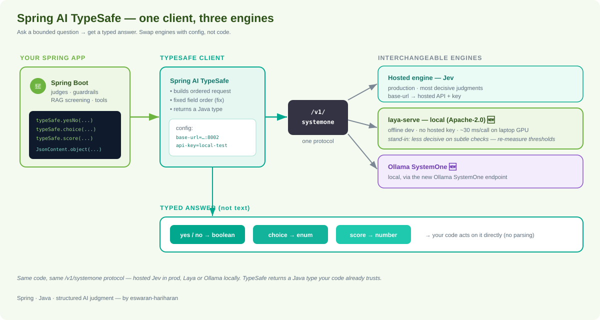
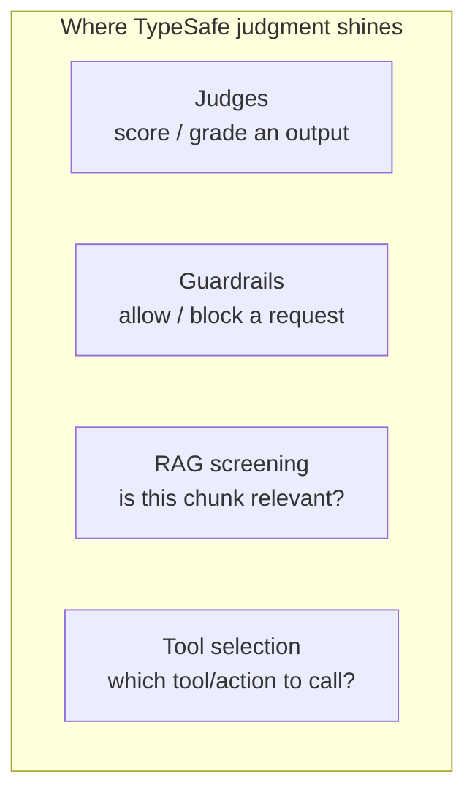
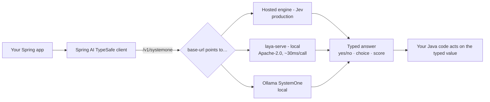

# Spring AI TypeSafe — Structured AI Judgment for Java

> **In one sentence:** Spring AI TypeSafe brings **structured AI judgment** to Java — you get **typed yes/no, choice, and score** answers instead of generated text, so AI decisions drop straight into your code as real Java types.

If a chat LLM *writes*, Spring AI TypeSafe makes the model *judge*. It's built for **judges, guardrails, RAG screening, and tool selection** — the places where you need a **decision**, not prose.



---

## 🆕 What's new in 0.3.0

The **0.3.0** release adds a big capability: you can now run the engine **locally**.

- **Laya support** — [Laya](https://lnkd.in/eX-ZiRcx) is an **open-source (Apache-2.0) System One engine** you can run on your own machine. It ships **`laya-serve`**, which speaks the **same `/v1/systemone` protocol** as the hosted TypeSafe engine (Jev).
- **Ollama SystemOne endpoint** — 0.3.0 also supports the new **Ollama SystemOne** endpoint, so you can drive TypeSafe judgments through Ollama too. ([Using Ollama SystemOne](https://lnkd.in/eYjMr-Xs))
- **Deterministic request ordering (bug fix)** — Laya surfaced a subtle bug: `Map.of(...)` iterates in a **different order on every JVM run**, and an order-sensitive model gave **different answers to identical code**. Requests now go out in a **fixed order**, and **`JsonContent.object(...)`** is the ordered one-liner for building your own content.

> Because Laya and Ollama speak the same protocol, you **point the client at them and everything works unchanged** — same code, different endpoint.

---

## What is "System One" judgment?

The name nods to *thinking fast* — quick, confident decisions. Instead of asking a model to generate a paragraph you then parse, you ask it a **bounded question** and get back a **typed answer**:

| Judgment type | You ask | You get back |
|---------------|---------|--------------|
| **Yes/No** | "Is this a valid support request?" | a typed `boolean` |
| **Choice** | "Which queue does this belong to?" | one value from your enum/options |
| **Score** | "How relevant is this document (0–1)?" | a typed numeric score |

The point: the answer is **already the right Java type** — no prompt-wrangling, no JSON parsing, no "did it hallucinate a field" checks.

---

## Why use it — the benefits

- **Type-safe results** — a yes/no comes back as a `boolean`, a choice as your enum, a score as a number. Your compiler and code trust it directly.
- **No prose to parse** — you don't post-process free text or write defensive JSON parsers.
- **Purpose-built for decisions** — judges, guardrails, RAG screening, tool selection — the exact spots where "plausible but wrong text" is unacceptable.
- **Spring-native** — configured through Spring Boot properties and injected like any other Spring bean; fits existing Spring AI apps.
- **Swappable backends** — the same `/v1/systemone` protocol is spoken by the hosted engine, **Laya** (local), and **Ollama**. Develop offline, deploy hosted, with **no code change**.
- **Fast + free locally** — with Laya you get **~30 ms per call on a laptop GPU**, **no hosted API key**, great for offline dev and experiments.

---

## Core use cases



- **Judges** — grade or score a model's output (quality, relevance, safety) with a typed score.
- **Guardrails** — a typed yes/no gate before a request proceeds.
- **RAG screening** — decide if a retrieved chunk is actually relevant before feeding it to a generator (cuts noise + cost).
- **Tool selection** — pick which tool/action an agent should call, as a typed choice.

---

## How to use it — developer guide

### 1. Configure the client (Spring Boot properties)

Point the TypeSafe client at whichever engine you want — hosted, Laya, or Ollama. **Only the config changes; your code stays the same.**

```properties
# --- Local Laya (offline dev) ---
spring.ai.typesafe.base-url=http://localhost:8002
spring.ai.typesafe.api-key=local-test
```

That's the exact config from the 0.3.0 announcement for running against a local `laya-serve` instance. Swap `base-url`/`api-key` for the hosted engine or an Ollama SystemOne endpoint when you deploy.

### 2. Ask typed questions (conceptual usage)

The whole idea is that you declare the **shape of the answer** and get that type back:

```java
// Yes/No guardrail — returns a boolean, not text
boolean isSafe = typeSafe.yesNo(
    "Is the following request safe to process?",
    JsonContent.object("request", userRequest)   // ordered, deterministic content
);

if (!isSafe) {
    return blocked();
}

// Choice — returns one of your options
SupportQueue queue = typeSafe.choice(
    "Which queue does this ticket belong to?",
    SupportQueue.class,
    JsonContent.object("ticket", ticketText)
);

// Score — returns a number (e.g. RAG relevance 0..1)
double relevance = typeSafe.score(
    "How relevant is this document to the question?",
    JsonContent.object("question", q, "document", chunk)
);
```

> **`JsonContent.object(...)`** is the **ordered one-liner** for building the content you send. Use it instead of `Map.of(...)`, which does **not** guarantee iteration order — see the ordering note below. *(Method names above are illustrative of the typed judgment API; check the release notes / GitHub for exact signatures.)*

### 3. Run Laya locally

Laya ships **`laya-serve`**, which exposes the same `/v1/systemone` protocol on your machine. Start it, point the client at `http://localhost:8002`, and your existing TypeSafe code runs unchanged — **no hosted API key needed**. See [Using Laya](https://lnkd.in/edS_b-BH).

### 4. Or drive it through Ollama

0.3.0 supports the new **Ollama SystemOne** endpoint, so if you already run Ollama locally you can route TypeSafe judgments through it. See [Using Ollama SystemOne](https://lnkd.in/eYjMr-Xs).

---

## The `Map.of` ordering bug (and the fix)

A subtle, real-world gotcha worth understanding:

- **The problem:** `java.util.Map.of(...)` makes **no ordering guarantee** — its iteration order can differ **on every JVM run**. An **order-sensitive model** therefore gave **different answers to identical code** across runs.
- **The fix (0.3.0):** TypeSafe now sends request fields in a **fixed, deterministic order**. For content you build yourself, use **`JsonContent.object(...)`** — the ordered one-liner — rather than `Map.of(...)`.

```java
// ⚠️ Non-deterministic order — can change per JVM run
Map.of("question", q, "document", d);

// ✅ Deterministic, ordered content
JsonContent.object("question", q, "document", d);
```

**Takeaway:** when a model's answer can depend on field order, make the order deterministic. TypeSafe now does this for its own requests, and gives you `JsonContent.object(...)` for yours. *(Reported by the community.)*

---

## ⚠️ Laya is a stand-in, not a drop-in replacement

The announcement is explicit about this, and it matters for correctness:

- Laya is **less decisive on subtle and world-knowledge checks** than the hosted engine.
- So if you tune **thresholds** (e.g. a score cutoff for RAG relevance or a guardrail), **re-measure them against Laya** — don't assume the hosted engine's thresholds carry over.
- Use Laya for **offline development and local experiments**; validate against the hosted engine before relying on it for production-grade judgments.

---

## How it fits together



**The mental model:** your Spring app calls the TypeSafe client → the client speaks `/v1/systemone` → whichever engine you configured (hosted Jev, local Laya, or Ollama) returns a **typed judgment** → your code acts on it directly. Switching engines is a **config change**, not a code change.

---

## Quick start checklist

1. Add Spring AI TypeSafe to your Spring Boot app (see [GitHub](https://lnkd.in/eDhmNEJ5)).
2. For local dev, run **`laya-serve`** and set `base-url=http://localhost:8002`, `api-key=local-test`.
3. Replace text-parsing AI calls with **typed** `yesNo` / `choice` / `score` judgments.
4. Build content with **`JsonContent.object(...)`** (ordered), not `Map.of(...)`.
5. **Re-measure thresholds** when running against Laya.
6. Point `base-url` at the hosted engine (or Ollama) for other environments — no code change.

---

## Reference links

- 📰 **Intro blog** (Spring blog): https://lnkd.in/eiCBXaEB
- 📝 **Release notes (0.3.0):** https://lnkd.in/eBp7_q47
- ⭐ **GitHub — Spring AI TypeSafe:** https://lnkd.in/eDhmNEJ5
- 📖 **Using Laya:** https://lnkd.in/edS_b-BH
- 📖 **Using Ollama SystemOne:** https://lnkd.in/eYjMr-Xs
- 🧩 **Laya (Apache-2.0):** https://lnkd.in/eX-ZiRcx

---

*This page summarizes the Spring AI TypeSafe 0.3.0 announcement. Code/method names are illustrative of the typed-judgment style; confirm exact API signatures, versions, and setup steps against the official release notes and GitHub repository before use.*
